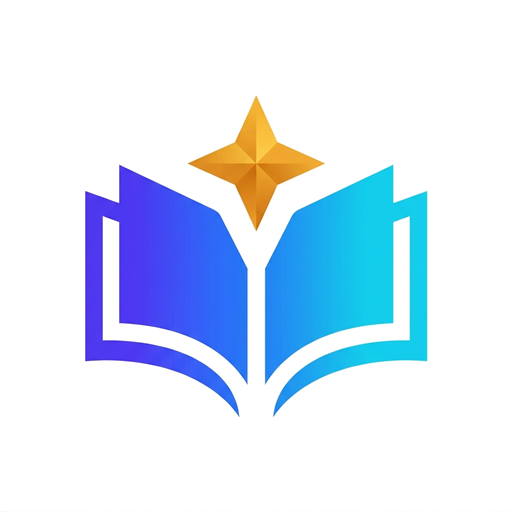

<p align="center">
  
</p>

<h1 align="center">Teach Skill (<code>teach-skill</code>)</h1>

<p align="center">
  <strong>Turn any folder into a persistent, interactive multimedia AI classroom for Google Antigravity.</strong><br/>
  Stateful multi-session tutoring • Vetted primary sources • Verified offline visuals &amp; teaching captions • Interactive SVG animations • Auto-generated Podcast Audio Overview • Printable PDF E-Books
</p>

---

## Why Teach Skill?

Ordinary AI chat is great for quick answers, but terrible for *actually learning* a new language, framework, or complex topic:
- Conversations scroll away and reset next session.
- Explanations come from unverified parametric memory instead of primary docs.
- Passive walls of text feel productive, yet nothing sticks a week later.

**Teach Skill** brings the stateful `/teach` workflow (inspired by Claude Code's `/teach`) to **Google Antigravity** — and expands it into a full **offline-first multimedia learning studio**. Every session remembers where you left off, verifies what you retained, and builds a personal library of illustrated lessons, interactive animations, audio podcasts, cheat sheets, and printable PDF e-books that you own forever.

---

## Key Features

- **Goal-First Onboarding (`MISSION.md`):** Interviews you on *why* you're learning, your current level, constraints, and preferred language before teaching a single concept.
- **Flexible Source Control (`sources/` + `RESOURCES.md`):** Choose between **3 Source Modes** during onboarding:
  - **`auto`:** AI searches and vets official docs, museums, and canonical guides automatically.
  - **`user-only` (AI Search OFF):** Drop your own paywalled academic papers, PDFs, e-books, notes into `sources/` (or paste YouTube/website links) — lessons and slides are built strictly from *your* materials with exact citations.
  - **`hybrid`:** Combines your private `sources/` as primary ground truth with vetted web references.
- **Verified Offline Visuals + Teaching Captions (`assets/`):** Downloads real Public Domain / Creative Commons images locally (no broken hotlinks) and enforces a mandatory **2-part caption** under every visual: *(1) what to notice & how it proves the concept* + *(2) creator, year, license, and source URL*.
- **Interactive Concept Animations (SVG/CSS/JS):** Embeds lightweight, zero-dependency step-through animations directly inside lessons to visualize mechanisms, flows, and timelines.
- **Auto-Generated Podcast Overview (NotebookLM-style):** Automatically writes a 2-host conversational summary and embeds an offline **Built-in Podcast Player** (Web Speech API with Play/Stop, speed control, and live-highlighted transcript) right inside the lesson — zero manual audio production required.
- **Interactive 16:9 Slide Decks (`slides/*.html`):** Generates zero-dependency Reveal-style web presentations in **PowerDeck Geometric Blue Diamond** or **Clean Scientific Modern** themes — max 3–4 lines per slide, photorealistic AI studio visuals in 45° diamond frames, inline SVG workflow diagrams, keyboard navigation (`←`/`→`), Speaker Notes (`N`), Fullscreen (`F`), and 16:9 PDF export — verified via real screenshot Visual QA.
- **Printable PDF E-Books (`ebook/*.html`) & Living Cheat Sheets (`reference/*.html`):** Compiles chapters into a Canva Editorial Magazine-style E-Book & Audiobook Reader (with `Aa` font slider, Dark Mode toggle, Waveform Audio Player, and 1-click **Print / Save as PDF**) alongside compact syntax/timeline reference sheets.
- **Active Recall & Mastery Logs (`learning-records/*.md`):** Runs a quick retention check before unlocking the next lesson and records what you've mastered, misconceptions cleared, and your next Zone of Proximal Development (ZPD).
- **Repo Safety Guard & Language-Adaptive:** Warns you before writing classroom files inside an active software repo, and adapts all files and audio to your language (Thai, English, etc.).

---

## Classroom Workspace Layout

When you run `/teach` in a dedicated folder, it builds and maintains this clean offline structure:

```text
my-learning-folder/
├── MISSION.md                  # Your goal, background, constraints & success criteria
├── RESOURCES.md                # Curated official docs, guides & verified visual credits
├── NOTES.md                    # Tutor scratchpad: your pace, style & sticking points
├── assets/                     # Local verified Public Domain / CC images (offline-safe)
├── lessons/
│   ├── 01-foundations.html     # Offline HTML lessons (visuals, SVG animation, podcast, quiz)
│   └── 02-next-concept.html
├── podcast/                    # Optional standalone podcast scripts or local audio
├── reference/
│   └── cheat-sheet.html        # Compact syntax tables, timelines & glossary
├── ebook/
│   └── topic-ebook.html        # Printable / Save-as-PDF compiled summary e-book
└── learning-records/
    └── 001-foundations.md      # ADR-style mastery logs & next ZPD target
```

---

## Included Offline HTML Templates

Every generated lesson and cheat sheet uses [`skills/teach/references/html-templates.md`](skills/teach/references/html-templates.md) — **100% offline-ready** (zero CDN scripts, zero remote fonts) with automatic Light/Dark mode (`prefers-color-scheme`):

1. **Interactive Multimedia Lesson (`lessons/NN-<slug>.html`)**
   - Core mental model + highlighted **Key Rule** invariant
   - Verified `<figure>` visuals with 2-part teaching captions & attribution
   - Inline **SVG/JS Step-Through Animation**
   - **Auto-Generated Podcast Player** with Play/Stop, speed selector, and live-synced transcript
   - **Active Check:** clickable multiple-choice quiz + **Think & Reveal** card + **Hands-On Drill**
   - **Sources Footer** citing `RESOURCES.md`
2. **Quick Reference (`reference/<topic>.html`)**
   - Scannable comparison tables and responsive glossary cards

---

## Quick Setup (Google Antigravity)

Clone or copy this repository into your Antigravity global plugins directory:

### Windows (PowerShell)
```powershell
git clone https://github.com/wsugree/teach-skill-for-antigravity-and-gemini.git "$env:USERPROFILE\.gemini\config\plugins\teach-skill"
```

### macOS / Linux
```bash
git clone https://github.com/wsugree/teach-skill-for-antigravity-and-gemini.git ~/.gemini/config/plugins/teach-skill
```

Antigravity discovers `teach-skill` automatically on your next turn. You can enable, disable, or inspect it anytime under **Customizations → Plugins**.

---

## How to Use

1. **Create a dedicated empty folder** for your topic:
   ```bash
   mkdir learn-photography && cd learn-photography
   ```
2. **Start your mission** in Antigravity:
   ```text
   /teach I want to learn the history and evolution of photography
   ```
3. **Continue across sessions:** Re-open the same folder days later and run `/teach`. Your tutor reads `MISSION.md` and `learning-records/`, checks what you remember, and unlocks the next lesson.

### Audio Podcast Voice Tip (Thai & Non-English Languages)
The built-in Podcast Player uses your browser's Web Speech API (`speechSynthesis`) with automatic language voice matching:
- **Fastest (recommended on Windows):** Open generated E-Book / lesson `.html` files in **Microsoft Edge**, which includes built-in natural voices for Thai (`Microsoft Premwadee` & `Microsoft Niwat`) and dozens of other languages with zero setup.
- **For Chrome / other browsers on Windows:** Install your language's voice pack via **Settings → Time & language → Speech → Manage voices → Add voices**, then restart the browser.

---

## Inspiration & License

Inspired by Matt Pocock's `/teach` stateful learning workflow for Claude Code, designed and authored from scratch for Google Antigravity with added offline multimedia, verified visual citations, interactive animations, auto-generated podcast overviews, and PDF e-books.

Released under the [MIT License](LICENSE).
