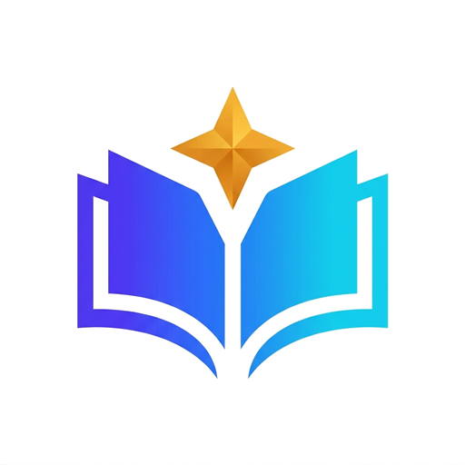

<p align="center">
  
</p>

<h1 align="center">Teach Skill สำหรับ Google Antigravity &amp; Gemini (<code>teach-skill</code>)</h1>

<p align="center">
  <strong>เปลี่ยนโฟลเดอร์ธรรมดาให้เป็นห้องเรียน AI แบบโต้ตอบได้สำหรับ Google Antigravity และ Gemini CLI</strong><br/>
  สอนต่อเนื่องข้ามเซสชัน • อ้างอิงแหล่งข้อมูลทางการ • บทเรียน HTML แบบออฟไลน์ • ติดตามความเข้าใจด้วย Active Recall
</p>

<p align="center">
  <a href="README.md">🇬🇧 English</a> • <strong>🇹🇭 ภาษาไทย</strong>
</p>

---

## ทำไมต้องใช้ Teach Skill?

การแชทถาม AI ทั่วไปเหมาะกับการหาคำตอบเร็วๆ แต่มักไม่ช่วยให้ *เรียนรู้ได้จริง* เมื่อต้องเรียนภาษาโปรแกรม เฟรมเวิร์ก หรือโค้ดเบสใหม่ๆ:
- ประวัติแชทเลื่อนหายและเริ่มใหม่ทุกครั้งที่เปิดเซสชัน
- คำอธิบายมักมาจากความจำของโมเดลโดยไม่ได้อ้างอิงเอกสารทางการ
- การอ่านข้อความยาวๆ ทำให้รู้สึกเหมือนเข้าใจ แต่ผ่านไปหนึ่งสัปดาห์ก็ลืม

**Teach Skill** นำเวิร์กโฟลว์ `/teach` แบบเก็บสถานะ (ได้รับแรงบันดาลใจจาก `/teach` ของ Claude Code) มาสู่ **Google Antigravity** โดยจัดการการเรียนรู้เป็นโปรเจกต์ที่มีไฟล์จริงอยู่ในเครื่องของคุณ ทุกครั้งที่กลับมาเรียน ระบบจะต่อยอดจากจุดเดิม ทบทวนสิ่งที่คุณจำได้ และค่อยๆ สร้างคลังบทเรียนกับ Cheat Sheet ส่วนตัวที่เปิดอ่านแบบออฟไลน์ได้ตลอดไป

---

## ฟีเจอร์หลัก

- **สัมภาษณ์เป้าหมายก่อนสอน (`MISSION.md`):** ถามเป้าหมาย ระดับพื้นฐาน ข้อจำกัด และภาษาที่ต้องการเรียน ก่อนเริ่มสร้างบทเรียนแรก
- **อ้างอิงแหล่งข้อมูลที่ตรวจสอบแล้ว (`RESOURCES.md`):** ค้นหาและคัดเลือกเอกสารทางการหรือคู่มือมาตรฐานก่อน แล้วแนบแหล่งอ้างอิงไว้ในทุกบทเรียน
- **บทเรียน HTML โต้ตอบได้แบบออฟไลน์ (`lessons/*.html`):** สร้างบทเรียนขนาดกระชับ (อ่านจบใน 5–10 นาที) ไม่พึ่งพาอินเทอร์เน็ต รองรับ Light/Dark mode มีแบบทดสอบปรนัย การ์ดกดดูเฉลย และแบบฝึกหัดลงมือทำ เปิดผ่าน `file://` ได้ทันที
- **Cheat Sheet สรุปคำสั่งอัตโนมัติ (`reference/*.html`):** รวบรวมตารางไวยากรณ์ คำสั่งสำคัญ และคำศัพท์ไว้ในหน้าเดียว และอัปเดตให้เรื่อยๆ ตามบทที่เรียนผ่าน
- **ทบทวนความจำและบันทึกความก้าวหน้า (`learning-records/*.md`):** ทดสอบความจำสั้นๆ ก่อนปลดล็อกบทถัดไป พร้อมบันทึกสิ่งที่เข้าใจแล้ว จุดที่เคยเข้าใจผิด และหัวข้อถัดไปที่เหมาะสม
- **ระบบป้องกันการสร้างไฟล์ปนโปรเจกต์จริง:** แจ้งเตือนก่อนสร้างไฟล์ห้องเรียน หากคุณเผลอเรียก `/teach` ในโฟลเดอร์ที่มีโค้ดโปรเจกต์อยู่แล้ว
- **ปรับภาษาตามผู้เรียน:** สอนและสร้างไฟล์ทั้งหมดเป็นภาษาไทย อังกฤษ หรือภาษาที่คุณต้องการได้ทันที

---

## โครงสร้างโฟลเดอร์ห้องเรียน

เมื่อคุณพิมพ์ `/teach` ในโฟลเดอร์ที่เตรียมไว้ ระบบจะสร้างและดูแลโครงสร้างนี้ให้อัตโนมัติ:

```text
my-learning-folder/
├── MISSION.md                  # เป้าหมาย พื้นฐาน ข้อจำกัด และเกณฑ์ความสำเร็จของคุณ
├── RESOURCES.md                # เอกสารทางการและแหล่งอ้างอิงที่คัดสรรแล้ว
├── NOTES.md                    # บันทึกของติวเตอร์เกี่ยวกับจังหวะการเรียนและจุดที่ต้องเน้น
├── lessons/
│   ├── 01-foundations.html     # บทเรียน HTML โต้ตอบได้ เปิดดูแบบออฟไลน์ได้
│   └── 02-next-concept.html
├── reference/
│   └── cheat-sheet.html        # ตารางสรุปไวยากรณ์ คำสั่ง และคำศัพท์
└── learning-records/
    └── 001-foundations.md      # บันทึกความก้าวหน้าและหัวข้อเป้าหมายถัดไป
```

---

## เทมเพลต HTML แบบออฟไลน์ในตัว

บทเรียนและ Cheat Sheet ทุกหน้าสร้างจากเทมเพลตใน [`skills/teach/references/html-templates.md`](skills/teach/references/html-templates.md) ซึ่ง **พร้อมใช้งานออฟไลน์ 100%** (ไม่ใช้ CDN หรือฟอนต์ภายนอก) และสลับ Light/Dark mode ตามระบบอัตโนมัติ:

1. **บทเรียนแบบโต้ตอบ (`lessons/NN-<slug>.html`)**
   - ป้ายชื่อบท เวลาเรียนโดยประมาณ (5–10 นาที) และความเชื่อมโยงกับ `MISSION.md`
   - แนวคิดหลัก (Mental Model) + กฎสำคัญ (**Key Rule**) + ตัวอย่างโค้ดกระชับ
   - **Active Check:** คำถามปรนัยพร้อมตรวจคำตอบทันที + ปุ่ม **Think & Reveal** สำหรับกดดูคำอธิบาย
   - **Hands-On Drill:** แบบฝึกหัดลงมือทำ 1–2 ข้อ เพื่อนำกลับมาคุยต่อในแชท
   - **Sources Footer:** อ้างอิงกลับไปยังแหล่งข้อมูลใน `RESOURCES.md`

2. **คู่มือสรุปย่อ (`reference/<topic>.html`)**
   - ตารางเปรียบเทียบ **Syntax & Patterns** (`รูปแบบ` / `ใช้เมื่อไร` / `ตัวอย่าง`)
   - การ์ดคำศัพท์ (**Glossary**) อธิบายสั้นกระชับในประโยคเดียว

---

## วิธีติดตั้ง (Google Antigravity)

โคลนหรือคัดลอก repository นี้ไปไว้ในโฟลเดอร์ปลั๊กอินของ Antigravity:

### Windows (PowerShell)
```powershell
git clone https://github.com/wsugree/teach-skill-for-antigravity-and-gemini.git "$env:USERPROFILE\.gemini\config\plugins\teach-skill"
```

### macOS / Linux
```bash
git clone https://github.com/wsugree/teach-skill-for-antigravity-and-gemini.git ~/.gemini/config/plugins/teach-skill
```

Antigravity จะตรวจพบปลั๊กอิน `teach-skill` โดยอัตโนมัติในรอบการทำงานถัดไป สามารถเปิด/ปิด หรือดูรายละเอียดได้ตลอดเวลาที่ **Customizations → Plugins**

> **หมายเหตุสำหรับ Gemini CLI:** หากต้องการนำไปใช้กับ Gemini CLI สามารถคัดลอกโฟลเดอร์ `skills/teach/` ไปไว้ในโฟลเดอร์ skills ของเครื่องมือได้เช่นกัน

---

## วิธีใช้งาน

1. **สร้างโฟลเดอร์เปล่าแยกสำหรับเรื่องที่จะเรียน:**
   ```bash
   mkdir learn-rust && cd learn-rust
   ```
2. **เปิดโฟลเดอร์นั้นใน Antigravity แล้วเริ่มเรียนด้วย `/teach`:**
   ```text
   /teach อยากเริ่มเรียน Rust เรื่อง ownership และ borrowing เพื่อเอาไปสร้างเครื่องมือ CLI
   ```
3. **กลับมาเรียนต่อในวันถัดไป:** เปิดโฟลเดอร์เดิมแล้วพิมพ์ `/teach` ติวเตอร์จะทบทวนความรู้จากบทก่อนหน้าและปลดล็อกบทเรียนถัดไปให้โดยอัตโนมัติ

---

## แรงบันดาลใจและสัญญาอนุญาต

ได้รับแรงบันดาลใจจากเวิร์กโฟลว์ `/teach` ของ Matt Pocock สำหรับ Claude Code โดยออกแบบและเขียนขึ้นใหม่สำหรับระบบปลั๊กอินและเครื่องมือของ Google Antigravity

เผยแพร่ภายใต้สัญญาอนุญาต [MIT License](LICENSE)
